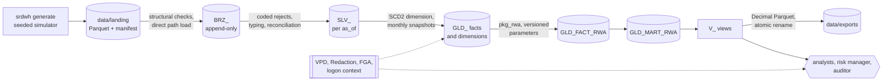

# secure-risk-dwh

[](https://github.com/abderrahimasmane/secure-risk-dwh/actions/workflows/ci.yml)

Credit-risk data platform on Oracle AI Database 26ai Free. Counterparty and exposure feeds land as Parquet, flow through a
bronze, silver and gold medallion, feed a standardised-approach credit RWA calculation, and are served to analysts under
row, column and audit controls enforced by the database itself.



## Quick start

Prerequisites: Linux or WSL2 with Docker, `uv`, `make`, `curl`, `unzip` and Java 17 or later (utPLSQL-cli).

```bash
cp .env.example .env    # fill every value, see below
make setup              # uv sync, pinned utPLSQL and utPLSQL-cli in .cache/
make e2e                # start Oracle, generate the dev profile, run the pipeline, check the access matrix
```

`.env` holds `SRDWH_ENV` (`dev` or `ci` create the profile accounts and the test framework), `SRDWH_DSN`
(`localhost:1521/FREEPDB1`) and one password per account: `ORACLE_PASSWORD`, `SRDWH_OWNER_PASSWORD`,
`SRDWH_ETL_PASSWORD`, `ANALYST_CORP_PASSWORD`, `ANALYST_RETAIL_PASSWORD`, `RISK_MANAGER_PASSWORD`, `AUDITOR_PASSWORD`,
`PROBE_NOPROFILE_PASSWORD`. Each password has 24 characters `[A-Za-z0-9]`, the first a letter. `.env` is never committed.

## Commands

| Command | Effect |
|---|---|
| `make up`, `make down`, `make reset` | start, stop, or rebuild the database from `db/` (volume dropped) |
| `make lint` | ruff, mypy --strict, sqlfluff, bronze mutation check |
| `make test` | pytest (unit and database suites) then utPLSQL |
| `make e2e [PROFILE=ci]` | up, generate, run and access-check on one profile |
| `uv run srdwh generate --profile dev [--seed N]` | write landing files, manifests and ground truth |
| `uv run srdwh run --profile dev [--rebuild-from YYYY-MM-DD]` | ingest, silver, gold, RWA, mart, exports |
| `uv run srdwh access-check` | compare every profile session with the access matrix, print it |

`srdwh run` exits 0 when done or when nothing is left to process, 1 on a technical or structural failure, 2 when a reject
rate exceeds `reject_threshold` (nothing replaced). Every run writes one JSON line per event on stdout; no name, LEI or
row amount appears in logs, errors or exports.

## Access matrix

| Account | Detail rows | Names, LEI | Marts | Audit trail |
|---|---|---|---|---|
| ANALYST_CORP, ANALYST_RETAIL | own segment | redacted | own segment | no |
| RISK_MANAGER | all | clear | all | no |
| AUDITOR | no grant | no grant | all | FGA records |
| PROBE_NOPROFILE | none | none | none | no |
| SRDWH_ETL (pipeline) | all | clear | all | no |

## Layout

```
src/srdwh/   generate/ contracts/ ingest/ pipeline/ export/ access/   Python CLI and pipeline
db/init/     account creation, deployment, dev and ci test framework
db/ddl/      ops, ref, bronze, silver, gold, params, packages, views, security
db/ref/      reference CSVs shared by the database and the simulator
db/tests/    utPLSQL suites and fixtures (golden RWA set)
tests/       pytest unit and integration suites
docs/        SPEC.md, architecture.md, runbook.md, adr/
```

## Documentation

- [Architecture](docs/architecture.md): components, data flow, run sequence, gold model, RWA chain, security.
- [Runbook](docs/runbook.md): operating procedures, exit codes, incidents, diagnostics.
- [Architecture decision records](docs/adr/).
- [Specification](docs/SPEC.md).
