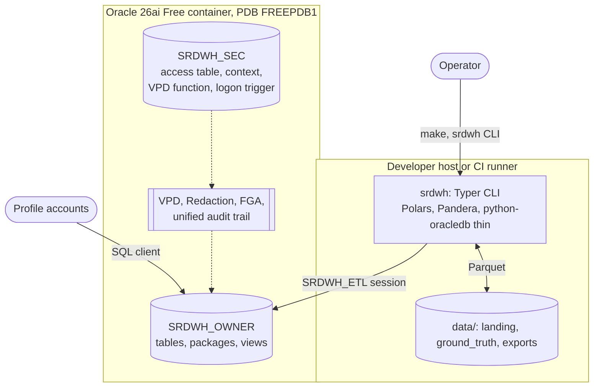
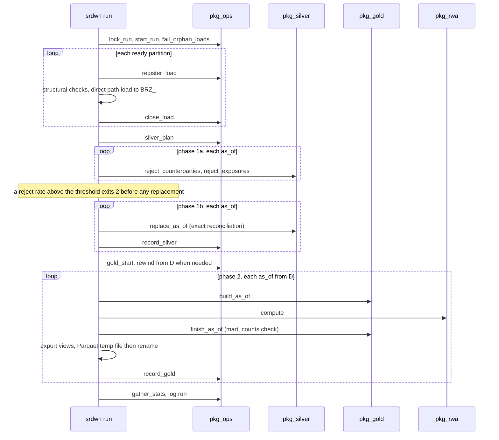
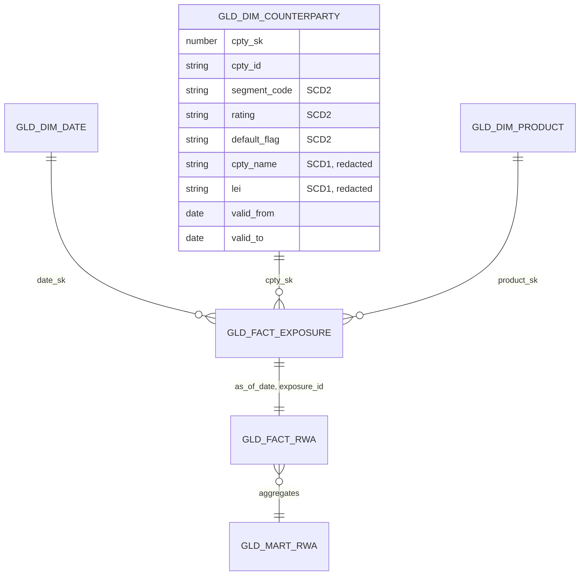
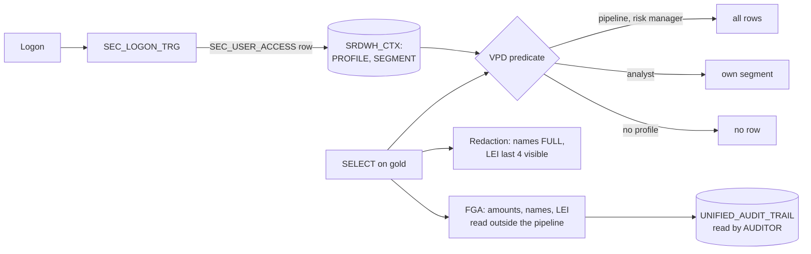

# Architecture

## Context and components

| Component | Responsibility |
|---|---|
| `srdwh generate` | seeded, deterministic simulator: counterparties, exposures, injected faults, independent ground truth |
| `srdwh run` | run lock, ingestion, phase orchestration, exports; owns every transaction |
| `pkg_ops` | run lock, load registry, as_of state, run and step log, statistics |
| `pkg_silver` | coded rejects (first failing rule), typing, silver replacement per as_of, exact reconciliation |
| `pkg_gold` | SCD2 and SCD1 counterparty dimension, exposure facts, mart, counts check, rewind |
| `pkg_rwa` | standardised RWA chain with the parameter version valid at the as_of |
| `pkg_err` | autonomous error log used by every package and the logon trigger |
| `srdwh access-check` | one session per profile account, compared cell by cell with the access matrix |

Packages never commit; Python commits once per unit of work. Rows are processed set-based in SQL; Python loops only over
files, partitions and batches.

## Layers

| Layer | Tables | Rule |
|---|---|---|
| Landing | `data/landing/<feed>/as_of_date=YYYY-MM-DD/` | Parquet zstd plus a manifest written last |
| Operations | `OPS_LOAD_REGISTRY`, `OPS_ASOF_STATE`, `OPS_RUN_LOG`, `OPS_ERR_LOG` | one row per load, as_of, step and error |
| Reference, parameters | `REF_*`, `PARAM_CCF`, `PARAM_HAIRCUT`, `PARAM_RISK_WEIGHT` | loaded at deployment; a parameter change is a new version |
| Bronze | `BRZ_COUNTERPARTY`, `BRZ_EXPOSURE` | text as delivered, append-only, partitioned per load |
| Silver | `SLV_COUNTERPARTY`, `SLV_EXPOSURE`, `SLV_REJ_*` | typed and validated, replaced per as_of, rejects with a reason code |
| Gold | `GLD_DIM_*`, `GLD_FACT_EXPOSURE`, `GLD_FACT_RWA`, `GLD_MART_RWA` | star schema, monthly snapshots, local bitmap indexes |
| Views | `V_RWA_BY_CLASS`, `V_RWA_TREND`, `V_TOP_EXPOSURES` | COREP C 07.00 breakdown, 12-month trend, top 20 |

## Run sequence

A rerun is idempotent: a delivered file with the same sha256 is skipped, an as_of whose silver and gold already match its
latest loads is not touched, and a late correction rewinds the gold from the corrected as_of.

## Gold model

Facts point to the counterparty version valid at their as_of. `segment_code` is copied onto the facts and the mart so the
row policy needs no join.

## RWA chain

| Step | Formula |
|---|---|
| Exposure class | `DEFAULTED` when `default_flag = Y`, else `segment_code` |
| Rating bucket | from `REF_RATING` (AAA and AA to AAA_AA, CCC to CCC_C) |
| EAD | `drawn_amt + CCF x undrawn_amt` |
| E* | `max(0, EAD - collateral_amt x (1 - Hc))`, with He = Hfx = 0 |
| RWA | `ROUND(E* x risk_weight, 2)`; intermediates stay unrounded |

Parameters carry a version and a validity range; the version valid at the as_of is recorded on every RWA row. The
golden set in `db/tests/fixtures/golden_rwa.sql` pins the chain to the cent (total 2,211,000.00).

## Security

- Roles `R_ANALYST`, `R_RISK_MANAGER`, `R_AUDITOR` grant SELECT on gold and views only; profile accounts receive
  ORA-00942 on bronze, silver, operations, reference, parameter and security objects.
- The context is set only by `pkg_sec_ctx`; the logon trigger never raises, so a failure leaves the session without a
  profile and therefore without rows.
- No application account holds an ANY privilege, an exemption, an audit administration role or the policy packages.

## Deployment

`docker compose up` runs `db/init` as SYS on the first start: `00_accounts.sh` creates the accounts from `.env`,
`10_deploy.sh` deploys `db/ddl` in name order and ends with a gate that fails on any invalid object or missing comment,
`20_dev_ci.sh` (dev and ci only) assigns the profiles and installs utPLSQL with the test suites. Environments are rebuilt
from `db/` rather than migrated. CI runs the same compose file and Makefile targets.

## Decisions

See [docs/adr](adr/).
