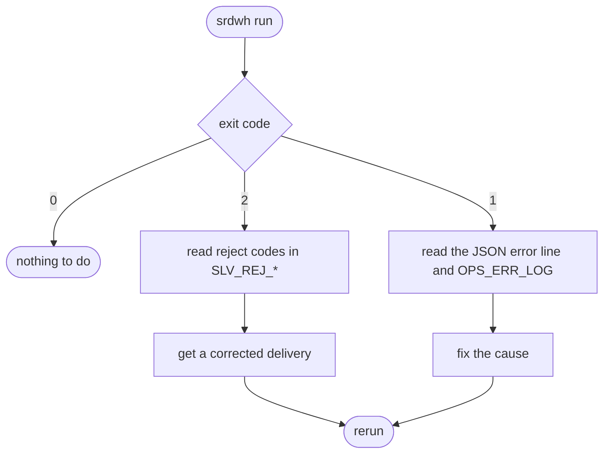

# Runbook

## Daily operation

```bash
make up                                        # database ready when the command returns
uv run srdwh run --profile dev                 # processes every ready partition, then exits
```

A partition is ready when its `manifest.json` exists; the producer writes it last. A file already loaded with the same
sha256 is skipped, so the command can be repeated at any time.



| Exit | Meaning | Action |
|---|---|---|
| 0 | run complete, or nothing to process | none |
| 1 | lock busy, invalid file, missing feed, Oracle error, reconciliation or count mismatch, export failure | read the `error` event and `OPS_ERR_LOG`, fix, rerun; recovery is automatic |
| 2 | reject rate above `reject_threshold` on at least one as_of; no silver or gold replaced | read the reject codes, obtain a corrected file (new sha256), rerun |

## Corrections and rebuilds

- Late correction: deliver the corrected partition with a new manifest; the next run detects the newer load, rewinds the
  gold from that as_of and rebuilds every later as_of.
- Forced rebuild: `uv run srdwh run --profile dev --rebuild-from 2025-06-30` rebuilds silver and gold from that as_of.
- Parameter change: add a complete new version to `db/ddl/60_params.sql` (close the current one, same validity in the
  three tables), then `make reset` and rerun.

## Incidents

| Symptom | Cause | Recovery |
|---|---|---|
| exit 1 after 60 s of connection retries | database down or still initialising | `make up`, rerun |
| `partition_not_ready` event | manifest missing, delivery in progress | none, loaded by a later run |
| `structural_check_failed` event | sha256, row count, schema or contract version mismatch | redeliver the file |
| `lock_busy` event | another run holds the lock | wait; never run two pipelines at once |
| a load stays `STARTED` after a kill | process stopped mid-load | none, the next run marks it `FAILED` and reloads |
| `threshold_breach` event | degraded delivery | corrected delivery |
| missing feed for an as_of | partial delivery | deliver the missing feed |
| ORA-20201 or ORA-20301 | reconciliation or count invariant broken: code defect | fix the code; the unit was rolled back |
| export failure | disk full, permissions | free space; gold and exports are rebuilt by the next run |
| a profile account sees no row | logon context not set | check `OPS_ERR_LOG` step `logon` and `SEC_USER_ACCESS`, reconnect |
| `srdwh access-check` exits 1 | a grant, policy or role differs from the matrix | read the KO lines, restore the deployment (`make reset` in dev) |
| ORA-28075 on a read of `cpty_name` or `lei` | transient Oracle failure to evaluate the redaction expression, seen just after a pipeline run (trace: ORA-25448 on `KWRIXEIEXP`); the policy itself is intact and no data is returned | reconnect and rerun the query after a few seconds |

## Diagnostics

Every session carries `client_identifier = run_id`, `module = srdwh` and `action = step`.

```sql
SELECT run_id, step, as_of_date, status, rows_in, rows_out, message
FROM srdwh_owner.ops_run_log WHERE run_id = :run_id ORDER BY started_at;

SELECT step, sql_code, message, backtrace
FROM srdwh_owner.ops_err_log WHERE run_id = :run_id ORDER BY logged_at;

SELECT load_id, feed, as_of_date, status, rows_expected, rows_loaded, rows_rejected
FROM srdwh_owner.ops_load_registry ORDER BY load_id DESC FETCH FIRST 20 ROWS ONLY;
```

The last JSON line of a run carries the exit code, the duration and the peak RSS of the Python process.

## Access verification

```bash
uv run srdwh access-check
```

It connects as every profile account, prints the matrix (roles, session privileges, detail rows, names, marts, hidden
layers, audit trail) and exits 0 only when every cell matches. FGA records can take up to 30 s to appear; the check
waits for them.

## Environment

`make reset` drops the volume and redeploys everything from `db/`; there is no migration path by design. Passwords come
from `.env` only; rotate them by editing `.env` and running `make reset`.
